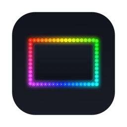
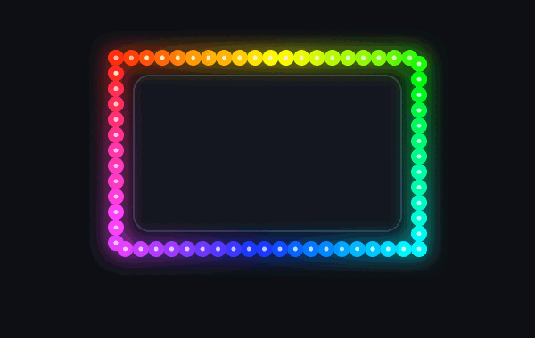
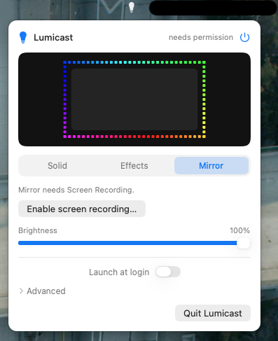
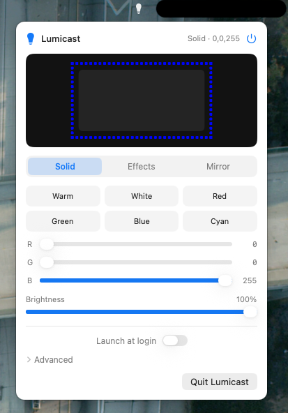

# Lumicast

A tiny, native macOS menu-bar app that drives a USB‑serial LED backlight behind your monitor —
screen mirroring, animated effects, or a solid color. **No network, no telemetry, no ads.** It only
reads your screen and writes colors to the strip.

> **Not affiliated with SkyDimo or any vendor.** "SkyDimo" and other names are trademarks of their
> respective owners.



## Why

The LED kit this was built for ships with a closed‑source app that phones home (activation, update
checks, ad fetches, usage logs) and shows ads. Lumicast does **none** of that — it has zero network
code. You get your lights back, privately, in about 1,000 lines of Swift you can read.

## Features

- **Effects** — Rainbow, Color cycle, Breathe, Comet, Wave (+ speed). Generated on‑device; needs no
  permissions.
- **Solid color** — presets + R/G/B sliders. Needs no permissions.
- **Mirror** — the strip follows your screen's edge colors (needs Screen Recording). The screen is
  only captured while Mirror is the selected mode.
- Brightness, color order (RGB/GRB), display picker, launch‑at‑login.
- A live preview of all the LEDs in the menu‑bar panel.
- **Goes dark when you're away** — the strip turns off when the display sleeps and on quit, logout
  or shutdown, and comes back in the mode you left it.

## Screenshots

<table>
  <tr valign="top">
    <td align="center"><br><sub>Effects</sub></td>
    <td align="center"><br><sub>Solid color</sub></td>
    <td align="center"><br><sub>Mirror</sub></td>
  </tr>
</table>

## Hardware / protocol

Built and tested against a **SkyDimo SK0L27** — [product page](https://www.amazon.com/dp/B0GHV5ZC25)
· [skydimo.com](https://skydimo.com/en/) — a 27", 4‑sided, 96‑LED kit. The protocol is generic, so it
should work with other CH340‑based Adalight‑style controllers too:

| Property | Value |
|---|---|
| Controller | CH340 USB‑serial (VID `0x1A86` / PID `0x7523`) |
| Port | auto‑detected by USB vendor ID (WCH, `0x1A86`); other vendors' serial adapters are never written to |
| Line | 115200 baud, 8N1, no flow control |
| Frame | `"Ada" + 0x00 + ledCount` (16‑bit big‑endian) header, then `count × 3` color bytes |
| Byte order | RGB (or GRB — toggle in the app) |

It's essentially **Adalight**, with the count sent as the LED count (not count−1) and no checksum
byte. Each frame must carry the header or the controller won't latch it.

**Other hardware:** Lumicast speaks the *Skydimo* flavor of Adalight (`Ada` + `0x00` + LED count, no
checksum), so it covers **SkyDimo's whole range** — 3‑/4‑sided kits, light strips, up to ~290 LEDs —
after adjusting `LAYOUT` and color order. Generic CH340 ambient‑light kits may work
too, but **standard Adalight** firmware expects a different header (count−1 plus a checksum byte), so
those need a small change to `frameHeader` in [`Sources/Core.swift`](Sources/Core.swift). A
controller built on a different USB‑serial chip needs its vendor ID added to `USB_VENDOR_IDS` in
[`Sources/Config.swift`](Sources/Config.swift). `ledprobe.c` is the quickest way to test any
controller. The same SkyDimo hardware is also supported by
[Hyperion/HyperHDR](https://hyperion-project.org) and Prismatik if you want a cross‑platform option.

## Build

Requires the Swift toolchain (Xcode or the Command Line Tools). No third‑party dependencies.

```sh
./build.sh        # universal Lumicast.app (Apple silicon + Intel, macOS 13+), ad-hoc signed
open Lumicast.app
```

A lightbulb icon appears in your menu bar — click it for the control panel (right‑click to quit).
To keep it around, drag `Lumicast.app` into `/Applications`.

## Wiring (important)

Everything you need to adapt to your strip lives in [`Sources/Config.swift`](Sources/Config.swift).
The LED count, the on‑screen preview and the screen‑mirror mapping all follow from one list,
`LAYOUT` — the sides in the order the data travels from the controller, with the LED count of each.
It defaults to a continuous loop wired **Left → Bottom → Right → Top**:

```swift
let LAYOUT: [(String, Int)] = [("left", 17), ("bottom", 31), ("right", 17), ("top", 31)]
```

Edit it to match your strip, then rebuild. Directions are worked out for you: each strip starts at
the corner where the previous one ended. A strip wired the other way round is just the sides in the
opposite order (`top, right, bottom, left`), and a 3‑sided kit simply leaves a side out.

## First run

- **Solid** and **Effects** work immediately — no permissions, and no permission prompt.
- **Mirror** needs Screen Recording: pick *Mirror* in the panel, click *Enable screen recording…*,
  approve it in System Settings, then **quit and reopen** Lumicast (macOS applies the grant on next
  launch). If the strip is black in Mirror mode, pick the correct monitor under *Display*.
- The power button in the panel turns the strip off and back on in the mode you were using.

## Troubleshooting

- **Fully quit the vendor's app** if you have it — only one program can own the serial port, and it
  locks `tty.usbserial*` plus a `/private/tmp/LCK..` lock file.
- **"no controller" in the panel** — the strip isn't plugged in, or its USB adapter isn't a
  recognised vendor. Replugging is picked up automatically within a second. To force a specific
  device: `defaults write com.abhinav.lumicast port /dev/cu.yourdevice` (delete the key to go back
  to auto‑detect).
- **Mirror asks for permission again after a rebuild** — an ad‑hoc signature ties the Screen
  Recording grant to that exact build. Remove the old Lumicast entry in System Settings (or run
  `tccutil reset ScreenCapture com.abhinav.lumicast`) and grant it again, or sign with your own
  certificate: `CODESIGN_IDENTITY="…" ./build.sh`.
- `ledprobe.c` / `streamtest_ada.c` are small standalone C probes used to verify the wire protocol.

## Tests

No LED hardware is needed — the engine is pointed at a pseudo‑terminal standing in for the
controller, and every byte it sends is checked.

```sh
tests/run.sh                        # layout, effects, frame format, and engine → wire
python3 tests/quit_test.py          # the built app: lights on, then dark when terminated
```

## License

[MIT](LICENSE).
