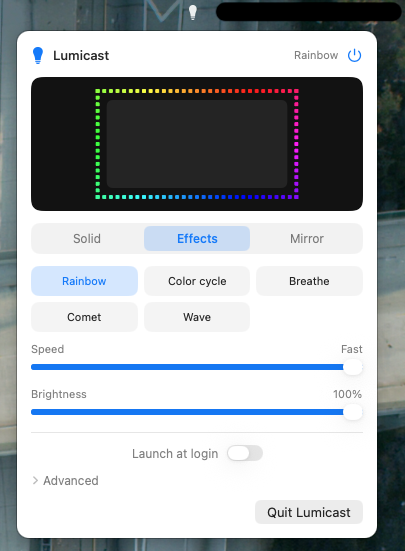

# Lumicast

A tiny, native macOS menu-bar app that drives a USB‑serial LED backlight behind your monitor —
screen mirroring, animated effects, or a solid color. **No network, no telemetry, no ads.** It only
reads your screen and writes colors to the strip.

> **Not affiliated with SkyDimo or any vendor.** "SkyDimo" and other names are trademarks of their
> respective owners.

  

## Why

The LED kit this was built for ships with a closed‑source app that phones home (activation, update
checks, ad fetches, usage logs) and shows ads. Lumicast does **none** of that — it has zero network
code. You get your lights back, privately, in ~800 lines of Swift you can read.

## Features

- **Effects** — Rainbow, Color cycle, Breathe, Comet, Wave (+ speed). Generated on‑device; needs no
  permissions.
- **Solid color** — presets + R/G/B sliders. Needs no permissions.
- **Mirror** — the strip follows your screen's edge colors (needs Screen Recording).
- Brightness, color order (RGB/GRB), display picker, launch‑at‑login.
- A live preview of all the LEDs in the menu‑bar panel.

## Hardware / protocol

Built and tested against a **SkyDimo SK0L27** — [product page](https://www.amazon.com/dp/B0GHV5ZC25)
· [skydimo.com](https://skydimo.com/en/) — a 27", 4‑sided, 96‑LED kit. The protocol is generic, so it
should work with other CH340‑based Adalight‑style controllers too:

| Property | Value |
|---|---|
| Controller | CH340 USB‑serial (VID `0x1A86` / PID `0x7523`) |
| Port | auto‑detected `cu.usbserial*` / `cu.wchusbserial*` |
| Line | 115200 baud, 8N1, no flow control |
| Frame | `"Ada" + 0x00 + ledCount` (16‑bit big‑endian) header, then `count × 3` color bytes |
| Byte order | RGB (or GRB — toggle in the app) |

It's essentially **Adalight**, with the count sent as the LED count (not count−1) and no checksum
byte. Each frame must carry the header or the controller won't latch it.

**Other hardware:** Lumicast speaks the *Skydimo* flavor of Adalight (`Ada` + `0x00` + LED count, no
checksum), so it covers **SkyDimo's whole range** — 3‑/4‑sided kits, light strips, up to ~290 LEDs —
after adjusting the LED count, `LAYOUT`, and color order. Generic CH340 ambient‑light kits may work
too, but **standard Adalight** firmware expects a different header (count−1 plus a checksum byte), so
those need a one‑line change to `HDR` in `Sources/main.swift`. `ledprobe.c` is the quickest way to
test any controller. The same SkyDimo hardware is also supported by
[Hyperion/HyperHDR](https://hyperion-project.org) and Prismatik if you want a cross‑platform option.

## Build

Requires the Swift toolchain (Xcode or the Command Line Tools). No third‑party dependencies.

```sh
./build.sh        # compiles Sources/*.swift, assembles Lumicast.app, ad-hoc signs it
open Lumicast.app
```

A lightbulb icon appears in your menu bar — click it for the control panel.

## Wiring (important)

The on‑screen preview and screen‑mirror mapping are generated from a `LAYOUT` descriptor in
[`Sources/main.swift`](Sources/main.swift). It defaults to a continuous loop wired
**Left → Bottom → Right → Top**:

```swift
let LAYOUT: [(String, Int)] = [("left", 17), ("bottom", 31), ("right", 17), ("top", 31)]
```

Edit it to match your strip order and per‑side LED counts, then rebuild.

## First run

- **Solid** and **Effects** work immediately — no permissions.
- **Mirror** needs Screen Recording: pick *Mirror* in the panel, click *Enable screen recording…*,
  approve it in System Settings, then **quit and reopen** Lumicast (macOS applies the grant on next
  launch). If the strip is black in Mirror mode, pick the correct monitor under *Display*.

## Troubleshooting

- **Fully quit the vendor's app** if you have it — only one program can own the serial port, and it
  locks `tty.usbserial*` plus a `/private/tmp/LCK..` lock file.
- If the port number changes after a replug, Lumicast auto‑detects the new `cu.usbserial*`.
- `ledprobe.c` / `streamtest_ada.c` are small standalone C probes used to verify the wire protocol.

## License

[MIT](LICENSE).
